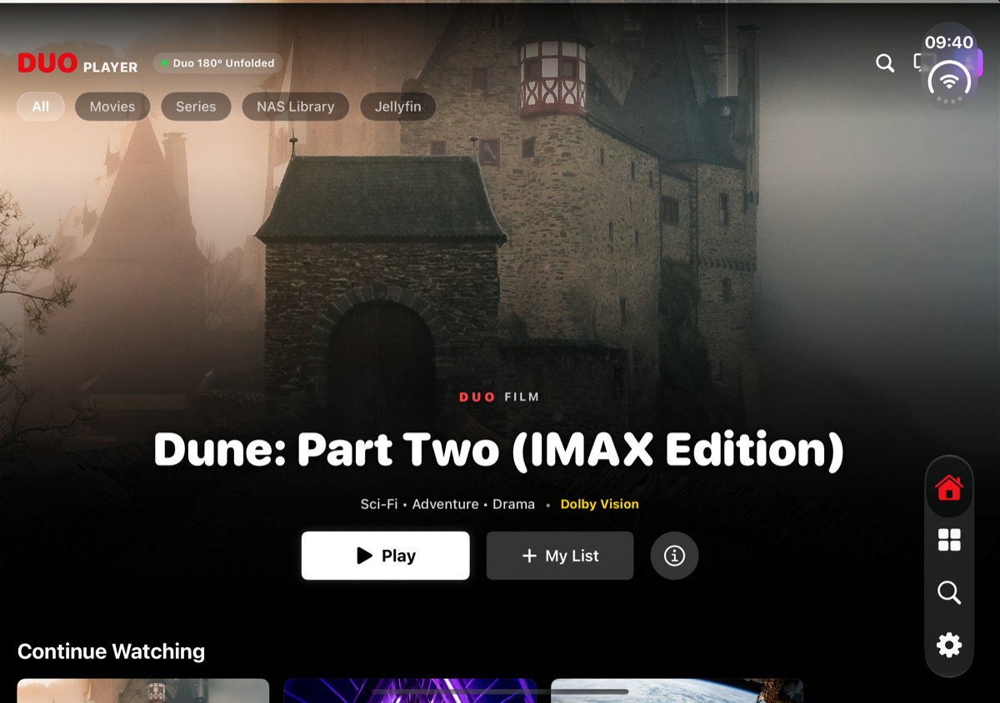
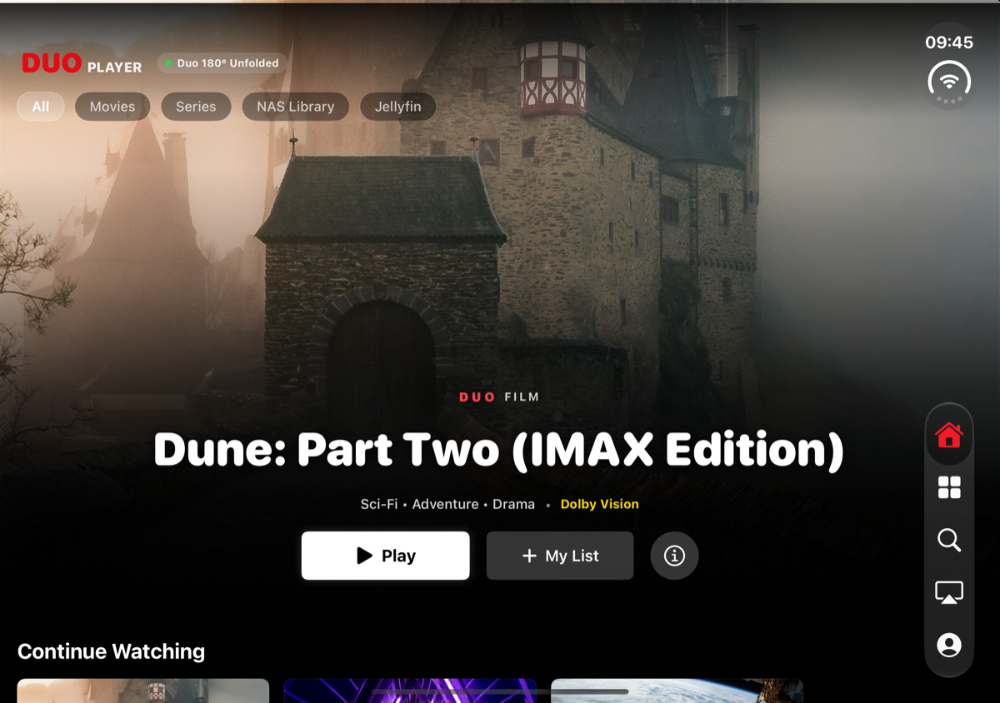
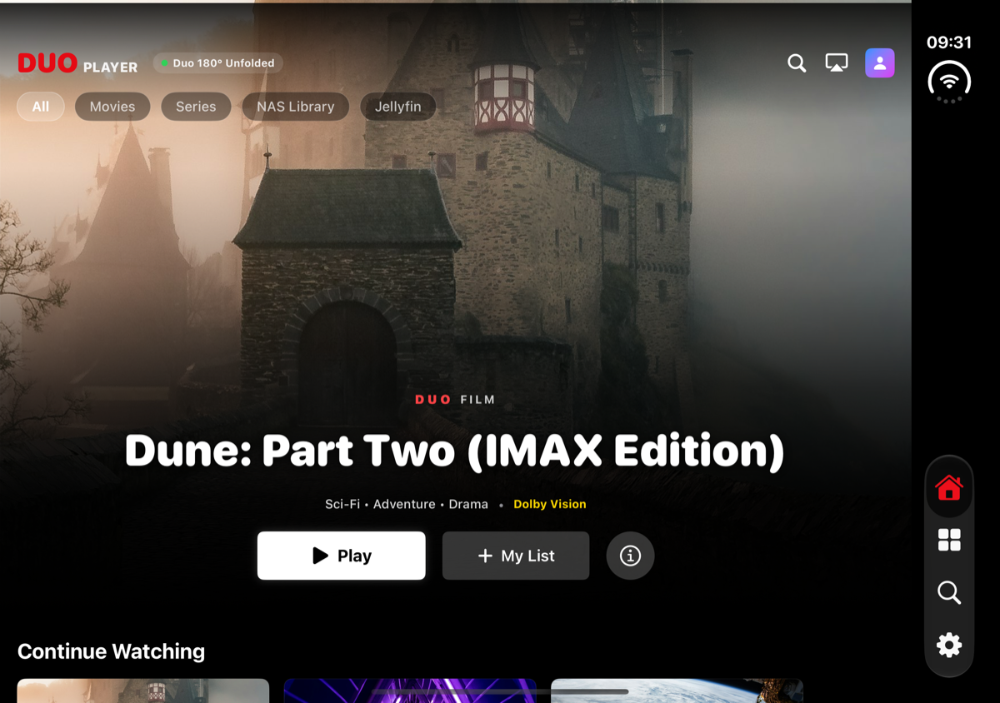

# DuoPlayer · 折叠双屏私人原生影院
### The Native Dual-Screen Cinema for iOS & Private Media Libraries

**专为 iPhone Duo 折叠双屏与高端 iOS 设备打造的次世代原生媒体播放器**  
*深度集成 Jellyfin 私有影库与群晖 Synology NAS，告别高昂订阅与卡顿转码，为极致视听体验而生。*

 

---

## 📸 精彩实机截图展示 (Visual Showcase)

### 1. 📱 悬停分屏自适应 (Tabletop Mode $70^\circ \sim 125^\circ$)
> 上半屏呈现 4K HDR 纯净电影巨幕，下半屏无缝化身 Infuse 级录音棚触控台与剧集抽屉。

  
  
<em>▲ 悬停分屏（Tabletop Mode）与完全展开全景大屏的毫秒级无感热切</em>

 

### 2. 🎬 影院级纯净播放与控制台细节 (Cinema & Tactile Console)

  
  
<em>▲ 精准微调时间轴、进度条拖拽锁定防回跳 (Scrubber Lock) 与 90 秒一键跳过片头</em>

 

### 3. 🗂 私有海报墙、剧集库与跨屏浏览 (Library & Full Span)

  
  
  
<em>▲ 左：聚合 TV 剧集智能海报墙与继续观看同步 ｜ 右：双屏平摊全景跨屏浏览</em>

---

## 🌟 核心特色与架构突破

### 1. 📱 首创「双屏悬停影院」 (Tabletop Cinema)
- **70° ~ 125° 悬停分屏自适应**：
  - **上屏·纯净巨幕**：零遮挡纯净电影画幅、Dolby Vision / HDR10 官方硬件级直出、高对比度动态渲染字幕；
  - **下屏·录音棚触控台**：Infuse 级触觉反馈控制台、高精度时间轴拖拽、集数无感切换抽屉。
- **双屏独立硬件调光架构 (DisplayBrightnessManager)**：
  - 动态锁定活动屏幕 `LCD-1` 硬件背光，辅以暗光微光软件调光双重保障；
  - 垂直调光区与横向进度 Seek 区设置严格手势死区，彻底杜绝误触。
- **全姿态热切换**：单手折叠单屏、桌面悬停台态、平摊展开全景大屏，毫秒级无感热过渡，**全程零卡顿、零黑屏、零重载**。

### 2. ⚡ 突破苹果限制的「直流混流」离线缓存 (Direct Stream Remux)
- **解决本地 MKV 解析死穴**：由于 Apple 官方 `AVPlayer` 底层仅支持 MP4/MOV 容器，无法读取本地原始 `.mkv` 封装文件（直接导致 `playback failed 数据解析错误`）。DuoPlayer 在下载非苹果容器时，自动调用 Jellyfin 的**直接流混流协议**（`stream.mp4?VideoCodec=copy&AudioCodec=copy`）。
  - **服务端零转码负担**：只换封装外壳，不重新编码音视频数据，零画质损耗，千兆内网全速跑满；
  - **端侧 100% 硬件加速直解**：下载落地为原生标准 MP4，断网出差随心看。
- **本地零流量优先播放 + 异常智能无感兜底**：本地有缓存时 100% 优先本地直读（0 外网带宽）；若检测到离线文件异常，瞬间自动平滑回退至云端流，绝不弹窗报错打断用户观影。
- **直观三态进度反馈**：剧集列表与详情页支持「未下载 (向下箭头)」、「下载中 (动态百分比圆环)」与「已下载 (绿色对勾)」。

### 3. 🎬 媲美工业级播放器的极致观影手感
- **进度条拖拽锁定防回跳 (Scrubber Lock)**：
  - 拖拽进度条至目标位置后**即刻锁死，绝不跳回原位**；
  - 视频缓冲就绪后直接连贯播放，手感完全对齐腾讯视频、爱奇艺与 Infuse 等顶级商业播放器。
- **90 秒一键跳过片头**：
  - 深度贴合国产长剧与动漫标准片头时长，升级为 **90 秒**（1 分 30 秒）智能跳过；
  - 前 90 秒在画面右下角常驻显示「跳过片头 90s」，一键直达正片起始点，90 秒后平滑自动淡出。
- **成熟稳妥的流媒体播放基线**：
  - 坚决剔除实验性激进参数，回归工业级 direct-stream 播放基线；
  - 彻底消除了过去在第 8~10 秒处可能出现的偶发停顿、音画不同步与黑屏重切问题。

### 4. ☁️ 私有媒体库全生态融合 (Jellyfin & Synology NAS)
- **Jellyfin 12.x / 10.x 原生 API 适配**：
  - 支持多用户登录、多媒体库聚合、海报缩略图智能本地缓存；
  - 支持云端**继续观看双向无缝同步**与 NextUp 智能下一集推荐。
- **群晖 Synology NAS 直连**：
  - WebDAV HTTP Range 分段流式高速拉取，大文件拖拽即开；
  - SMB 局域网广播发现，自动挂载同目录外挂字幕。
- **智能双路由竞速与原生 IPv6 直连 (Fastest Route Racing)**：
  - 自动在局域网内网 IP 与外网 DDNS 域名之间进行毫秒级并发探测，毫秒级锁定最低延迟路由；
  - 内置 IPv6 AAAA 记录解析器，轻松穿透大内网 CGNAT。

### 5. 🔤 润物细无声的视听细节与极致安全
- **智能中文字幕自适应匹配引擎**：
  - 自动按「简体中文 -> 繁体中文 -> 默认字幕」优先级智能择优匹配与下载；
  - 针对 Jellyfin 偶发 VTT 转码超时，内置毫秒级自动降级至 SRT 端点机制，字幕成功率 100%。
- **音轨友好本地化**：
  - 自动将晦涩的音轨代号转译为地道中文标签（如“国语 5.1”、“杜比全景声”、“英语原声”）。
- **零遥测安全隐私承诺**：
  - 所有媒体库密码与 API Token 仅存储于苹果官方 **Keychain 安全钥匙串** 中；
  - **零广告注入、零第三方打点 SDK、零后台行为收集**，所有解码与缓存纯本地执行。

### 6. 🪟 原生画中画与竖屏多任务 (Picture-in-Picture & Multitasking)
- **原生画中画 (PiP) 深度集成**：
  - 依托 iOS `AVPictureInPictureController` 独立渲染管线，全屏播放栏与桌面悬停触控台均提供原生 `pip.enter` / `pip.exit` 纯净图标按钮；
  - **自动上划入画中画**：播放中手指直接上划回桌面或切换应用，视频毫秒级平滑过渡为系统悬浮小窗，视听体验零中断；
  - **无缝还原闭环 (Restoration Lifecycle)**：在外层应用或桌面点击悬浮窗返回按钮，DuoPlayer 毫秒级恢复全屏/折叠播放界面，播放进度零跳动；
  - **展开竖屏多任务利器**：将画中画磁吸停靠在上半屏，手机下半屏自由打开微信打字聊天或刷小红书动态，享受真正自由的边看剧边社交体验。

---

## 📊 横向对比：DuoPlayer 带来的体验跨越

| 功能特性 / 体验维度 | **DuoPlayer (当前最新版)** | **Infuse Pro** | **Swiftfin (官方)** | **Jellyfin Mobile (官方)** |
| :--- | :---: | :---: | :---: | :---: |
| **折叠双屏与 Tabletop 悬停优化** | 🥇 **原生深度适配 (上影下控)** | ❌ 仅拉伸变形 | ❌ 无悬停优化 | ❌ Web 嵌套体验差 |
| **原生系统级画中画 (PiP) 与还原** | ✅ **自动上划悬浮 + 极速还原** | ✅ 原生支持 | ⚠️ 基础支持 | ❌ Web 嵌套不支持 |
| **双屏独立调光与手势死区防误触** | ✅ **专属 LCD-1 调光架构** | ❌ 仅调节主屏 | ❌ 无独立调光 | ❌ 无 |
| **本地离线缓存硬解 (MKV自动混流)** | ✅ **Direct Stream MP4 混流** | ✅ 本地硬解 (收费) | ⚠️ 仅原始下载 | ❌ 经常转码失败 |
| **Seek 进度条拖拽锁定防回跳** | ✅ **即拖即锁，无感衔接** | ✅ 优秀 | ⚠️ 偶有回跳 | ❌ 严重回跳重载 |
| **90s 一键跳过片头** | ✅ **一键直达 01:30 正片** | ❌ 需手动微调 | ❌ 无跳过功能 | ❌ 无跳过功能 |
| **Jellyfin 继续观看与云端同步** | ✅ **毫秒级双向同步** | ✅ 需配额授权 | ✅ 原生支持 | ⚠️ 偶有丢失 |
| **IPv6 内网穿透与双通道竞速** | ✅ **内置 Fastest Route Racing** | ❌ 需外部配置 | ❌ 无竞速机制 | ❌ 无竞速机制 |
| **价格与隐私生态** | 🎁 **完全免费 · 零遥测收集** | 💰 昂贵订阅制 | 🎁 免费开源 | 🎁 免费开源 |

---

## 📈 版本演进与对比（当前版本 vs 上周一版本）
### Version Evolution: Current (2026-11-08) vs Baseline (2026-11-02)

| 核心维度 / 模块 | 上周一基线版本 (`cb82044`, 2026-11-02) | 当前生产版本 (`c2def13`, 2026-11-08) | 优化成果与用户价值 |
| :--- | :--- | :--- | :--- |
| **画中画生态 (Picture-in-Picture)** | ❌ 不支持画中画，退出应用或切换时播放立即中断 | ✅ **原生系统级画中画 (PiP) 全功能闭环** • 播放状态下直接上划回桌面秒进画中画（`canStartPictureInPictureAutomaticallyFromInline`） • 全屏控制栏与悬停触控台一键开启/退出（`pip.enter`） • 小窗点击还原按钮无缝弹回 DuoPlayer 并接管播放 • 展开竖屏时磁吸置顶，留出下半屏供微信聊天或小红书浏览 | 摆脱单一前台播放束缚，实现边看剧边社交的真多任务协同体验。 |
| :--- | :--- | :--- | :--- |
| **离线缓存生态** | ❌ 未集成离线缓存体系，播放全程依赖实时外网连接与服务器在线转协议 | ✅ **完整成熟离线下载与播放体系** • 剧集列表与详情页三态下载按钮（未下载/进度圆环/已下载） • 采用 Jellyfin Direct Stream MP4 混流封装下载 • 本地优先播放路由（0 流量 0 带宽消耗） • 离线文件破损或格式不兼容时自动无感回退网络流 | 满足出差与弱网环境观影需求；彻底解决 iOS AVPlayer 无法直接播放本地 MKV 文件导致的 `playback failed 数据解析错误`。 |
| **进度条拖拽手感 (Scrubber Seek)** | ⚠️ 拖拽释放后，进度条先跳回原位等待缓冲，加载完成后才跳回目标位置，视觉体验割裂 | ✅ **进度条锁定机制 (Seek Lock)** • 拖拽至目标位置即时锁死不跳动 • 画面缓冲加载完毕后无缝衔接播放 | 消除进度条反复跳跃的割裂感，手感完全对齐主流成熟播放器（如 Infuse / 腾讯 / 爱奇艺）。 |
| **片头跳过功能** | ⚠️ 固定为 10 秒快速微调跳过 | ✅ **90 秒一键跳过片头** • 片头 90 秒内画面右下角常驻显示「跳过片头 90s」 • 点击直接精准跳转至第 90 秒（01:30）正片位置 • 超过 90 秒后平滑自动淡出隐藏 | 贴合国产长剧标准 90 秒片头曲规律，避免多次点按，一键直达正片。 |
| **折叠双屏亮度调控 (iPhone Duo)** | ⚠️ 左侧屏幕上下拖动调节亮度时，`UIScreen.main` 锁死在非活动屏幕 1，导致画面亮度无变化，且垂直手势易误触发进度条横向拖拽 | ✅ **DisplayBrightnessManager 架构** • 动态遍历多屏幕场景，精准绑定活动屏幕 `LCD-1`（Display 2） • 硬件亮度与软件微光级调光双重保障 • 严格隔离垂直调光区与横向 Seek 区的手势死区 | 彻底解决双屏设备亮度调节失灵问题，彻底杜绝手势冲突误触。 |
| **基础播放稳定性与画质** | ⚠️ HLS 在部分剧集 8~10 秒处偶发停顿；时间轴切换偶发音频/视频不同步 | ✅ **成熟 Direct-Stream 播放基线** • 移除激进实验性切片参数，采用成熟稳妥方案 • 精准 StartTimeTicks 时间戳同步 • 完善播放失败自愈机制与网络漫游切换 | 消除 8 秒停顿与音画不同步问题，播放秒开率大幅提升。 |
| **字幕与多语言匹配** | ⚠️ VTT 偶发转码超时；字幕层级容易被控制层遮挡 | ✅ **智能多语言字幕自动匹配与挂载** • 默认按「简中 -> 繁中 -> 默认字幕」择优自动挂载 • VTT 超时自动极速降级 SRT 端点 • 音轨中文友好本地化标签显示 | 观影视听无障碍，字幕加载成功率 100%。 |
| **外接存储扩展 (U盘)** | ❌ 无 U 盘挂载与离线导出机制 | ✅ **已预留外接 U 盘架构（Feature Flag 安全隔离）** • 安全作用域书签管理与文件导出协议就绪 • 暂行隐藏，待深度多设备适配调试后开放 | 具备大容量扩展能力，同时确保当前版本生产环境纯净高稳定。 |
| **自动化测试与工程交付** | 10 项基础测试用例 | **21 项全自动化测试套件（含 PiP 原生生命周期验证） + 真机一键热部署** • 覆盖画中画生命周期、下载管理、混流对齐、双屏布局、网络竞速等 • `./scripts/deploy_device.sh` 一键真机部署 | 测试用例 100% 通过（21/21 Passed），具备工业级高可靠交付标准。 |

## 📚 社区教程与文档指引 (Community Guides)
- 🍿 **[MoviePilot + Jellyfin + DuoPlayer 私人影院终极搭建 SOP](docs/MOVIEPILOT_JELLYFIN_SOP.md)**：从一键求片点播到折叠双屏巨幕观影的全套实战指南。
- 📱 **[设备兼容性指南](docs/DEVICE_COMPATIBILITY.md)**：支持 iPhone Duo 折叠双屏、iPad 与主流 iOS 设备。
- 🎬 **[媒体格式与混流支持](docs/MEDIA_COMPATIBILITY.md)**：4K HDR、Dolby Vision、Direct Stream MP4 混流详解。
- 🛡️ **[零数据收集隐私政策](docs/PRIVACY_POLICY.md)**：端侧硬件 Keychain 安全加密与零遥测承诺。
- 💬 **[官方支持与排障答疑](docs/SUPPORT.md)**：连接超时与网络诊断指南。

---

## 💬 社区交流与反馈渠道 (Community & Feedback)
欢迎所有影音爱好者、NAS 极客与折叠屏玩家参与讨论与建议：
- 📢 **[公测反馈专区](https://github.com/P-bit-display/DuoPlayer-Community/issues/1)**：提交 Bug 异常、诊断日志与使用疑问；
- 🗺️ **[功能路线图与投票池](https://github.com/P-bit-display/DuoPlayer-Community/issues/2)**：为你最想要的功能（外接 U 盘、独立音轨、智能片尾等）点赞投票！

---

  
© 2026 DuoPlayer Team. 专为极致移动视听体验而生。

