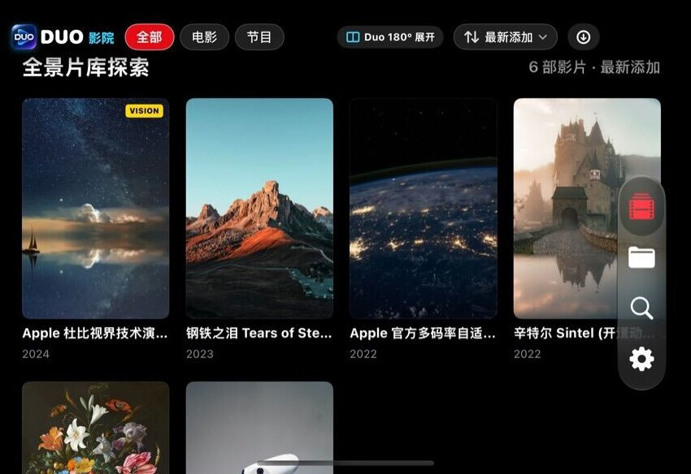
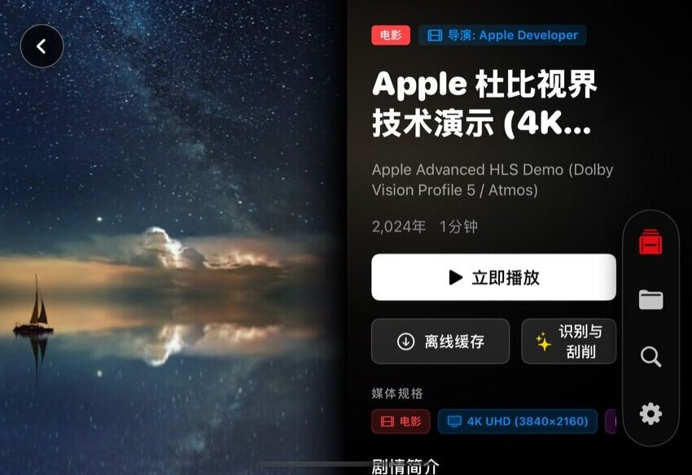

# DuoPlayer · iPhone Jellyfin / Emby 客户端与 NAS 视频播放器

[English](README.en.md) · [English playback compatibility guide](docs/jellyfin-webdav-playback-en.md)

DuoPlayer 是一款 iOS 视频播放器，可连接 Jellyfin、Emby 和群晖 Synology NAS 的 WebDAV 片库。在 iPhone Duo 上支持折叠屏桌面播放布局。

把 iPhone Duo 半折放在桌上，上半屏看电影，下半屏拖进度、换字幕。手指留在控制区，画面留给电影。

**[在 App Store 下载 DuoPlayer](https://apps.apple.com/us/app/duoplayer-video-player/id6830926628?l=zh-Hans-CN)** · [连接 Jellyfin](docs/MOVIEPILOT_JELLYFIN_SOP.md) · [连接群晖 WebDAV](docs/synology-webdav-iphone.md) · [反馈问题](https://github.com/P-bit-display/DuoPlayer-Community/issues/new?template=bug_report.md)

*桌面播放布局示例。注意时间轴和字幕入口的位置。*

### 你的片子放在哪里？

| 已有的片库 | 从这里开始 |
| --- | --- |
| Jellyfin 或 Emby | 添加服务器，用自己的账号登录，从媒体库选一集播放。 |
| 群晖或其他提供 WebDAV 的 NAS | 添加 WebDAV 服务地址和媒体目录，浏览自己的视频文件。 |
| 通过系统「文件」访问的目录 | 在添加媒体源时选择已挂载目录，并授权 DuoPlayer 读取。 |

DuoPlayer 用来播放你已有访问权限的媒体，片源由你提供。出差前可以在有下载入口的影片详情页保存一集，再切到飞行模式，从下载列表试播并确认字幕。

### 最新界面截图

| 片库浏览 | 影片详情 |
| --- | --- |
|  |  |

[查看紧凑布局、桌面模式和书本模式截图](docs/DEVICE_COMPATIBILITY.md)

### 使用与交流

[设备与布局](docs/DEVICE_COMPATIBILITY.md) · [MKV、字幕与 HDR](docs/MEDIA_COMPATIBILITY.md) · [连接排障](docs/SUPPORT.md) · [隐私政策](docs/PRIVACY_POLICY.md) · [需求征集](https://github.com/P-bit-display/DuoPlayer-Community/issues/2)

**English** — DuoPlayer is a Jellyfin and Emby client for iPhone and an iOS video player for self-hosted media libraries, including Synology NAS over WebDAV. In the tabletop layout, the video sits above the timeline and subtitle controls. [Download on the App Store](https://apps.apple.com/us/app/duoplayer-video-player/id6830926628?l=zh-Hans-CN) · [Support](docs/SUPPORT.md)
