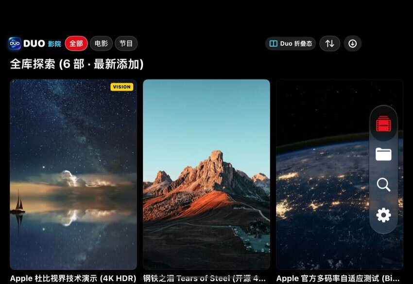
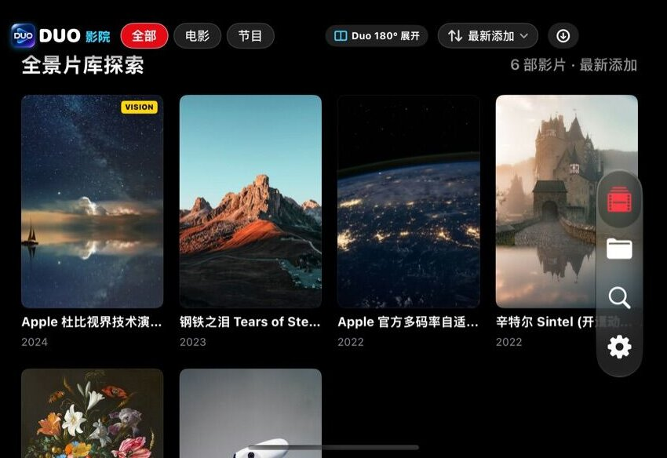
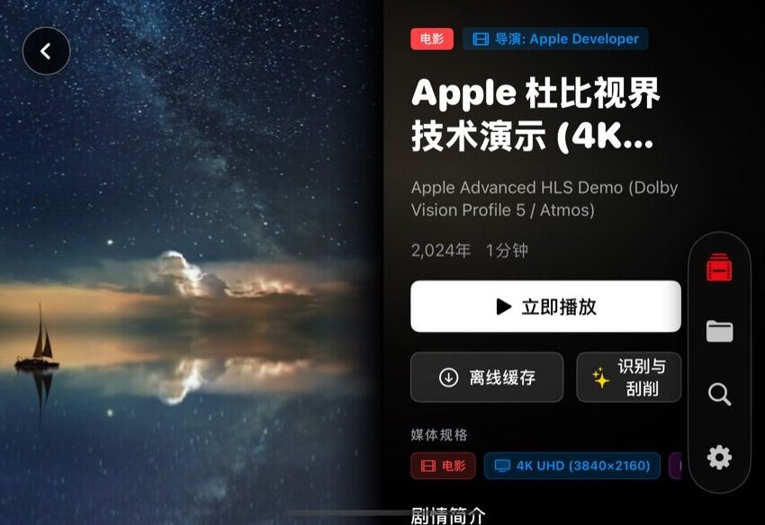
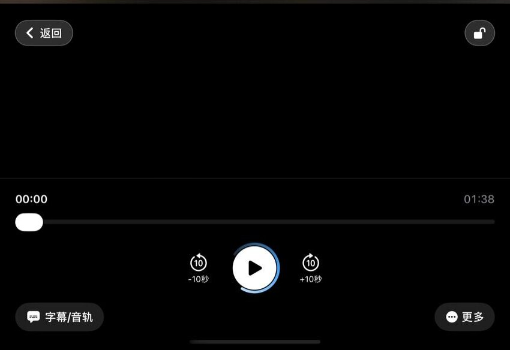
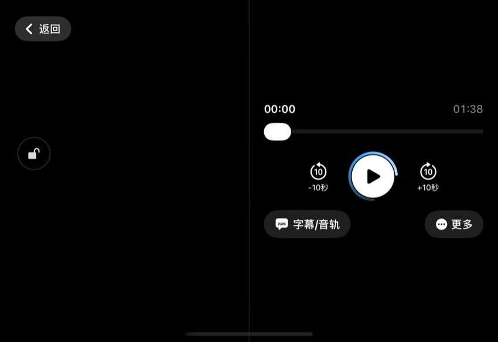

# 设备与播放布局

安装前请在目标设备打开 [DuoPlayer 的 App Store 页面](https://apps.apple.com/us/app/duoplayer-video-player/id6830926628?l=zh-Hans-CN)，查看「兼容性」一栏。商店会显示该版本要求的系统和设备。

| 使用方式 | 可以观察什么 |
| --- | --- |
| 单屏观看 | 打开影片，点按画面显示播放控件。 |
| iPhone Duo 桌面布局 | 上方显示影片，下方放置时间轴、播放和字幕控件。 |
| 展开或旋转 | 返回同一段影片，观察画面与控件如何随可用空间重新排列。 |

如果布局和预期不同，请在[问题反馈](https://github.com/P-bit-display/DuoPlayer-Community/issues/new?template=bug_report.md)中注明设备、系统和 App 版本、屏幕方向，以及折叠或旋转前后的表现。这样其他用户也能判断自己的设备是否遇到同一问题。

## 界面截图

以下界面截图来自 2026 年 11 月 22 日的项目验收。

| 布局或页面 | 截图 |
| --- | --- |
| 紧凑布局的片库 |  |
| 展开布局的片库 |  |
| 影片详情 |  |
| 桌面模式控制区（播放前） |  |
| 书本模式控制区（播放前） |  |

[查看桌面模式正在播放的示例](assets/tabletop-controls.jpg)
