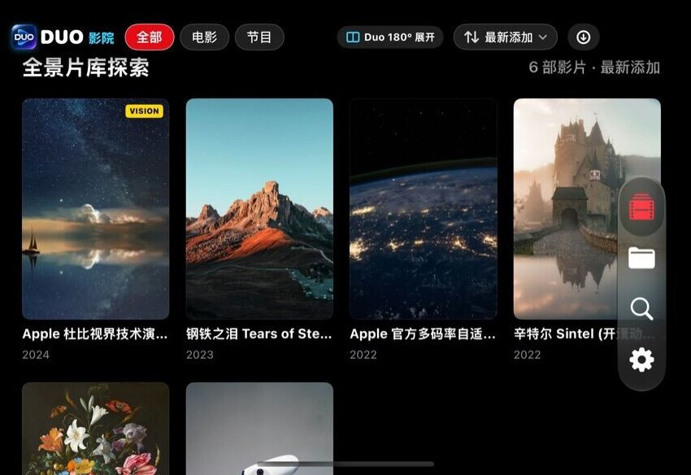

# 把家里的 Jellyfin 片库接到 DuoPlayer

如果手机浏览器已经能打开家里的 Jellyfin，直接从第 2 步开始。准备一段你有权播放的短视频，方便确认整个流程。

1. **先确认片库可用。** 手机连接家庭 Wi-Fi，打开自己的 Jellyfin 地址，用观影账号登录。在网页里打开同一段视频，确认账号能看到媒体库并播放。
2. **在 DuoPlayer 添加服务器。** 打开添加媒体源，选择「Jellyfin / Emby 影音服务器」。填入刚才使用的服务器地址、账号和密码，点「测试连接」，成功后保存。
3. **播放第一段视频。** 在媒体库找到刚才的片子并播放。试着暂停、拖动进度和选择字幕；使用 iPhone Duo 桌面布局时，可以在下方控制区操作。
4. **想在路上看？** 在详情页查看是否有下载入口。下载完成后切换到飞行模式，在下载列表打开同一集，确认画面、声音和字幕。

### 如果你已经在用 MoviePilot

保留现有整理流程，让 Jellyfin 媒体库指向整理后的目录。新增一部影片后，先在 Jellyfin 扫描并确认网页能看到它，再刷新 DuoPlayer。这样能区分问题出在目录整理、服务端入库还是手机客户端。已经建好 Jellyfin 片库的用户可以直接连接。

### 如果你用的是群晖 WebDAV

在 NAS 上确认已启用 WebDAV，观影账号对媒体目录有读取权限。在 DuoPlayer 选择 WebDAV 类型，填入该服务实际使用的协议、端口和目录。群晖管理后台地址和 WebDAV 服务地址可能不同。

[下载 DuoPlayer](https://apps.apple.com/us/app/duoplayer-video-player/id6830926628?l=zh-Hans-CN) · [连接失败时逐步排查](SUPPORT.md) · [分享你的搭建经验](https://github.com/P-bit-display/DuoPlayer-Community/issues/3)
