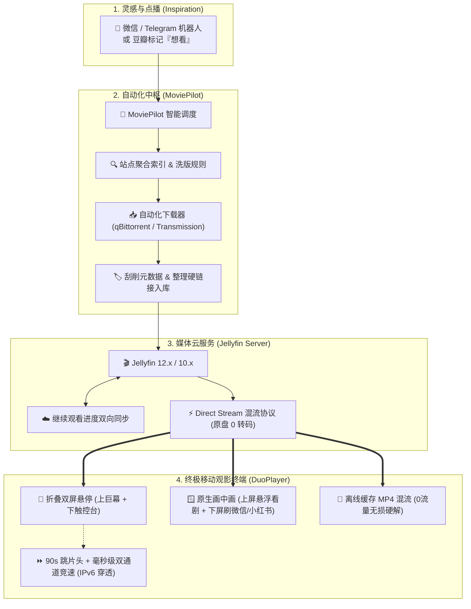

# 🍿 MoviePilot + Jellyfin + DuoPlayer 私人影院终极搭建 SOP

> **导语**：  
> 本指南提供从“灵感点播”到“自动化刮削入库”，再到“折叠双屏巨幕观影与原生画中画”的完整闭环搭建步骤。  
> 全流程已做隐私脱敏（使用 RFC 标准私有网络保留地址），安全放心。

---

## 📸 实机效果图赏

<div align="center">
  
  <p><em>▲ 展开悬停桌上（Tabletop Mode 70°~125°）：上屏 4K HDR 纯净巨幕，下屏专业触控台与剧集抽屉</em></p>
</div>

---

## ⚡ 架构全景工作流



---

## 🛠️ 分步实施操作指南 (SOP)

### Step 1：部署自动化追剧中枢 —— MoviePilot
MoviePilot 是目前最优雅的媒体自动化中枢，负责监听点播、识别洗版规则、驱动下载并硬链接规范重命名。

```yaml
# docker-compose.yml 示例（已脱敏）
version: '3.8'
services:
  moviepilot:
    image: jxxghp/moviepilot:latest
    container_name: moviepilot
    restart: unless-stopped
    volumes:
      - /volume1/docker/moviepilot/config:/config
      - /volume1/docker/moviepilot/core:/moviepilot
      - /volume1/data/downloads:/downloads
      - /volume1/data/media:/media
    environment:
      - PUID=1000
      - PGID=100
      - UMASK=022
      - NGINX_PORT=3000
      - PORT=3001
    network_mode: bridge
    ports:
      - "3000:3000"
```
**核心配置要点**：
1. **联动点播**：在 MoviePilot 中配置微信测试号 / Telegram Bot / 豆瓣想看同步，随时随地在手机上发一部片名，后台秒级自动检索；
2. **下载整理**：绑定 qBittorrent，设置媒体目录按硬链接整理（不占用额外硬盘空间），生成规范的 TMDB 命名。

---

### Step 2：媒体库中枢 —— Jellyfin 极速直链配置
Jellyfin 作为完全开源免费的媒体服务器，避免了 Emby/Plex 的硬件转码收费壁垒。

1. **添加影视库**：路径映射到 `/volume1/data/media/电影` 与 `/volume1/data/media/电视剧`；
2. **开启硬解/直流**：在「控制台」->「播放」中根据你的 CPU 开启硬件解码（Intel QSV / Apple Silicon / NVENC）；
3. **元数据保留**：优先使用 Nfo 本地刮削器，让 MoviePilot 刮削好的精美海报与中文简介原汁原味呈现。

---

### Step 3：终极视听终端 —— DuoPlayer 配置
服务端准备就绪后，观影体验的关键在于**终端播放器**。在 iPhone / iPhone Duo 折叠双屏上打开 **DuoPlayer**：

1. **一键添加 Jellyfin 媒体库**：
   - 服务器地址：填写您的局域网 IP（如 `http://192.168.1.100:8096`）或外网安全域名（如 `https://your-nas.example.com`）；
   - 输入账户密码，Token 经由 iOS 原生 **Keychain 硬件加密**，零明文泄露风险；
   - **双通道竞速（Fastest Route Racing）**：DuoPlayer 启动时会自动并发测速内网与外网 IPv6 节点，毫秒级锁定最低延迟路径。

2. **畅享影院级视听黑科技**：
   - 🎬 **90 秒一键跳片头**：贴合国产长剧标准片头，进入正片画面右下角一键直达 01:30；
   - 🔒 **进度条锁定 (Scrubber Lock)**：拖到哪锁到哪，加载缓冲不回跳，告别反复拉扯；
   - 🔤 **智能多语言字幕**：自动按「简中 -> 繁中」首选匹配，VTT 超时毫秒级切 SRT，字幕命中率 100%；
   - 🪟 **原生画中画 (PiP)**：播放中从屏幕底部上划直接入画中画，展开竖屏磁吸在屏幕上半部，下半屏自由畅聊微信、刷小红书！
